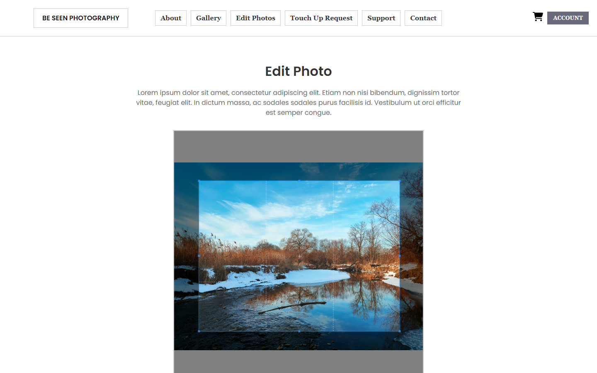

# Be Seen Photography (IT 299 Capstone)

My Purdue Global IT 299 integrative capstone project: a front-end prototype of a photography studio website where customers can browse photos, crop and edit them, request touch-ups, and walk through an order.

This was a three-person team project built in June 2025. It is a front-end prototype: the pages, layout and photo editor work in the browser, but the forms and checkout are not connected to a server and no payments are processed.

**Live link:** none. The site runs by opening the files locally (see below).

## Features

- **Home, About and Contact pages** with a navigation bar shared across all 11 pages.
- **Photo gallery** with buttons to edit a photo or request a touch-up.
- **Photo editor** that lets a customer crop, rotate, zoom and reset a photo, then save the edited image to their computer.
- **Touch-up request form** where a customer writes instructions for the editor.
- **Order flow pages:** cart, checkout, confirmation, account and support (layout with placeholder items).

## My part

The commit history shows what I built:

- The navigation bar used on every page
- The site's main stylesheet and fonts
- The Home, About and Contact pages
- The crop tool on the Edit Photo page
- Fixes for a broken stylesheet link and a wrong navigation link name

Teammate [Deidra](https://github.com/DeidraAlexander) built the cart, checkout, confirmation, account and support pages. Teammate Jordan ([CryptViper](https://github.com/CryptViper)) built the gallery, photo editing and touch-up request page content.

## Tech stack

- HTML5, CSS3, JavaScript
- Bootstrap 5 (forms and layout on some pages)
- Cropper.js (the photo crop tool)
- Google Fonts (Poppins)
- Git and GitHub for team collaboration (branches, a pull request and merges)

## How I built it with AI

The commit history shows no AI coding tools on this project, so there is no AI process to describe here. The quality checks visible in the history are manual ones: fixing a stylesheet link that did not load on several pages, and correcting a navigation link name across the site.

## Run it locally

No install needed.

1. Download or clone this repository.
2. Open `index.html` in a web browser.

The photo editor loads Cropper.js from the internet, so it needs a connection.
